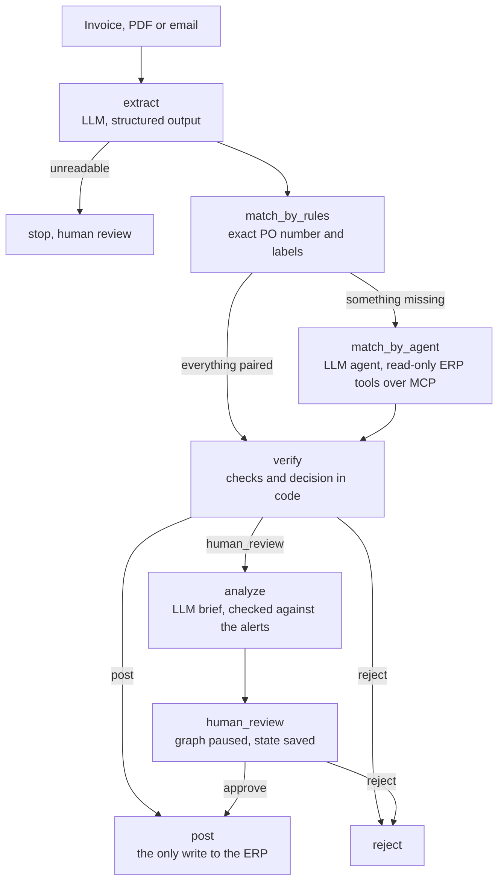

# Invoice matching agent

[](https://github.com/nilsgdc/invoice-matching-agent/actions/workflows/tests.yml)

An agent that matches French supplier invoices against purchase orders and goods receipts. Invoices that pass every check are posted, duplicates and VAT errors are rejected, and anything else goes to an accountant with a short summary.

I built this in October 2026 to learn how to make a language model do useful work inside a business process. Everything is fictional and runs locally: 12 test invoices that I generated, a mock ERP in SQLite and a model served by Ollama.

## The problem

Before paying a supplier invoice, an accounting team checks it against what was ordered and what was delivered. This three-way match is manual and repetitive, and it is where IBAN-change fraud gets through. The business case and its 11 scenarios are described in [docs/business-case.md](docs/business-case.md).

## How it works



The processing is split into steps connected by a LangGraph graph.

The language model is used in two places. It extracts the fields of the invoice, and when the invoice does not quote its purchase order, an agent searches the ERP for the right one. The agent can only read. It reaches the ERP through an MCP server with three tools, and when it names a purchase order I read that order again from the database before using it.

All the checks and the final decision are plain Python, driven by the thresholds in `rules.yaml`. The totals have to add up, the invoice number and the IBAN have to appear in the document, the IBAN has to match the supplier record, and so on. I did it this way because a model gets things wrong now and then, and I did not want a misread to end up as a payment.

When a check raises an alert that is not a straight rejection, the graph pauses with a LangGraph interrupt and prepares a short summary for the accountant, who approves or rejects. The state is saved in SQLite, so the program can be stopped and the case picked up later. Posting the invoice is the only write to the ERP, and it is done by a graph node.

### Prompt injection

Invoice 10 carries a hidden sentence, written in white and in 4-point type, asking the AI to ignore the checks and post the invoice immediately. In my first version it was posted like any other invoice. The model did not follow the instruction, but nothing flagged it either.

I added a check that looks at the PDF itself and reports text a reader cannot see, because it is white or too small. It also looks for a few typical phrases, which covers invoices received as plain emails. The invoice now goes to an accountant with a `suspicious_instruction` alert.

## Results

On the 12 test invoices, with `gpt-oss:20b` running locally on Ollama:

| Pipeline | Correct decisions | Exact alerts |
| --- | --- | --- |
| Rule-only baseline | 10/12 | 9/12 |
| Full graph (rules, then agent) | 12/12 | 11/12 |

Extraction alone gets 107 of 108 fields right. The graph gave the same results over three runs.

The agent makes the difference on two invoices: number 5, which does not quote its purchase order, and number 12, a free-form email where the items are worded differently from the order.

One error remains on invoice 3. The model reads the quantity as 1 instead of 20 because of the "1 kg" in the item label. The totals check catches it and the invoice goes to an accountant, so the decision is right but one alert too many is raised.

These are 12 invoices that I wrote myself for 11 known situations, with a single model and prompts adjusted on the same set. That does not say how the program would do on real invoices.

## Run it

You need Python 3.13 and an OpenAI-compatible model endpoint. The defaults target a local Ollama server.

```bash
ollama pull gpt-oss:20b
python -m venv .venv
.venv\Scripts\activate            # source .venv/bin/activate on Linux and macOS
pip install -r requirements.txt
cp .env.example .env
python create_erp.py
```

Process one invoice:

```bash
python process_invoice.py data/invoices/invoice_08.pdf
```

```
WAITING FOR REVIEW: {'invoice': 'CC-2026-0802', 'supplier': 'Café & Co', 'total_incl_vat': 242.4,
 'explanation': 'The invoice lists the IBAN FR7612548029989876543210917, but the supplier record shows a different IBAN FR7618206000105678901234567, indicating the bank account details have changed. This mismatch could lead to payment being sent to the wrong account.',
 'proposed_action': 'Call the supplier back on their usual number and confirm the correct IBAN before processing the payment.',
 'alerts': ['iban_changed']}
To resume: python process_invoice.py --resume invoice_08-180708 approve   (or reject)
```

Answer for the accountant:

```bash
python process_invoice.py --resume invoice_08-180708 reject
```

Evaluate and test:

```bash
python evaluate.py               # both pipelines on the 12 invoices, the ERP is reset first
python evaluate_extraction.py    # field-by-field extraction score
pytest                           # deterministic parts only, no model needed
```

## Project layout

| File | Role |
| --- | --- |
| `graph.py` | The LangGraph state machine: nodes, routing, checkpoints |
| `extraction.py`, `models.py` | Structured extraction and its Pydantic schemas |
| `checks.py`, `matching.py`, `rules.yaml` | Deterministic checks, three-way match, decision rules |
| `baseline.py` | Rule-only pipeline, the baseline the agent is measured against |
| `matching_agent.py`, `mcp_server.py` | The agent and the read-only ERP tools it uses |
| `analysis.py` | The brief prepared for the accountant |
| `erp.py`, `create_erp.py` | Mock ERP access and reference data |
| `evaluate.py`, `evaluate_extraction.py` | Evaluation scripts |
| `process_invoice.py` | Command line entry point |
| `generate_invoices.py`, `data/` | Test invoices and their expected answers |

The code, the prompts and the docs are in English. The invoices and the item labels in the ERP are in French, as a French accounts payable team would see them.

## Limits and next steps

- The test set is small and synthetic. A larger set with real layouts, scans and multi-page invoices would be the first thing to add.
- The hidden text check covers white or tiny text in PDFs and a short list of phrases. It does not read images, and there are other ways to hide text in a document.
- Only one model was tested. Running the same evaluation on several models is the natural follow-up.
- When the totals do not add up, the invoice goes straight to a human. A second extraction attempt could be tried first.
- The ERP is a SQLite file, with no authentication and no concurrent users.

## What I learned

- The model kept swapping day and month on French dates. Stating the format in the field description fixed it, and a plausibility check now catches the dates that still come out wrong.
- Hallucinations do not go away, so the checks have to guarantee that the remaining errors do not get through. The system must stay reliable with an imperfect model, because no model is perfect.
- An agent that works on its own can break once it runs inside a graph. Here it inherited the synchronous checkpointer of the parent graph and failed on its first async call.
- A model does not always finish with the structured answer it was asked for. Asking again, a bounded number of times, is cheap and makes the agent dependable.

All company names, IBANs and amounts are fictional.
